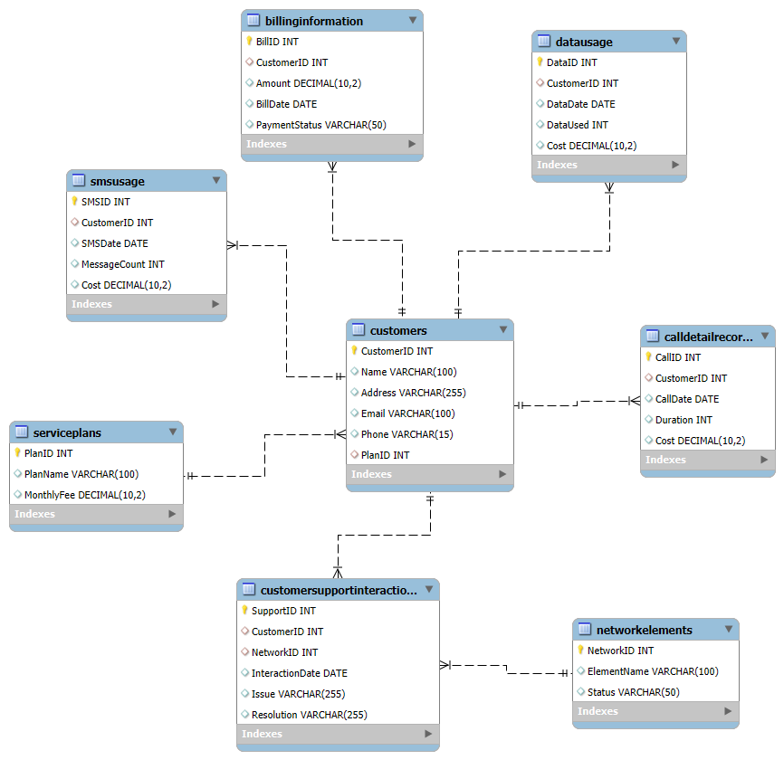

# Relational Database Design for a Telecom Provider

MySQL database for a fictional telecom company, designed as part of my MSc Data Analytics (BSBI, Berlin). The project covers the full path from data model to business questions: an entity-relationship diagram, an 8-table schema with keys and constraints, sample data, and ten analytical queries.

## What's inside

- `telecom_db.sql`: creates the schema, loads the sample data and runs the queries
- `telecomdb.png`: the entity-relationship diagram

## Data model



`Customers` is the central table. Each customer has one service plan and many usage, billing and support records.

| Table | What it stores | Links to |
|-------|----------------|----------|
| `ServicePlans` | plan name and monthly fee | |
| `Customers` | name, address, contact details | `ServicePlans` |
| `CallDetailRecords` | call date, duration (minutes), cost | `Customers` |
| `SMSUsage` | date, message count, cost | `Customers` |
| `DataUsage` | date, data used (MB), cost | `Customers` |
| `BillingInformation` | bill amount, date, payment status | `Customers` |
| `NetworkElements` | cell towers and their status | |
| `CustomerSupportInteractions` | issue, resolution, date | `Customers`, `NetworkElements` |

Every table has an auto-increment primary key, and foreign keys enforce the relationships, so a usage record or bill cannot exist without a valid customer.

## Example queries and results

The sample data holds 21 customers, 20 service plans and one day of usage (1 June 2025).

**Who are the highest-value customers by usage?** Three-table join with aggregation:

```sql
SELECT Customers.Name,
    (SUM(CallDetailRecords.Cost) + SUM(SMSUsage.Cost) + SUM(DataUsage.Cost)) AS TotalUsageCost
FROM Customers
JOIN CallDetailRecords ON Customers.CustomerID = CallDetailRecords.CustomerID
JOIN SMSUsage ON Customers.CustomerID = SMSUsage.CustomerID
JOIN DataUsage ON Customers.CustomerID = DataUsage.CustomerID
GROUP BY Customers.CustomerID
ORDER BY TotalUsageCost DESC;
```

| Name | TotalUsageCost |
|------|----------------|
| Noah Allen | 28.80 |
| Ivy Harris | 23.50 |
| Alice Johnson | 20.80 |
| Grace Lee | 20.70 |
| Quinn Adams | 20.10 |

*(top 5 of 20 rows)*

**Which customers have not paid their bill?** Join with a filter:

```sql
SELECT Customers.CustomerID, Customers.Name, BillingInformation.Amount, BillingInformation.BillDate
FROM Customers
JOIN BillingInformation ON Customers.CustomerID = BillingInformation.CustomerID
WHERE BillingInformation.PaymentStatus = 'Unpaid';
```

Result: 7 of 20 bills are unpaid, worth 101.00 out of 257.00 billed (39 %).

**Who used more than 1,000 MB of data?** Aggregation with `HAVING`:

```sql
SELECT Customers.Name, SUM(DataUsage.DataUsed) AS TotalDataUsed
FROM DataUsage
JOIN Customers ON DataUsage.CustomerID = Customers.CustomerID
GROUP BY Customers.CustomerID
HAVING TotalDataUsed > 1000;
```

| Name | TotalDataUsed |
|------|---------------|
| Alice Johnson | 1500 |
| Eve Martinez | 1200 |
| Grace Lee | 1500 |
| Ivy Harris | 1200 |
| Mia Young | 1300 |
| Noah Allen | 1500 |

The other queries in the script cover customer lookups, customers per plan, a single customer's bill, and total call cost per customer.

## What I learned

- Designing a normalised schema from a business description and drawing the ERD
- Using primary and foreign keys to keep data consistent
- Writing joins, aggregations, `GROUP BY` and `HAVING` to answer business questions
- Thinking about CAP-theorem trade-offs when a system like this has to scale

## Limitations and next steps

- The sample data is small (about 20 rows per table, a single day), so the results show that the queries work and are not meant as analysis.
- The usage queries join the call, SMS and data tables directly. That is correct here because each customer has one row per table, but with several records per customer the totals would be multiplied. The fix is to sum each usage table per customer first and then join the totals.
- Support interactions are not yet linked to a cell tower: the `NetworkID` column exists but is empty in the sample data. Filling it would allow questions such as "which towers generate the most complaints?".

## How to run

Open `telecom_db.sql` in MySQL Workbench (or any MySQL client) and run it. It creates a database called `telecom`.

**Tools:** MySQL, MySQL Workbench, SQL, data modelling
